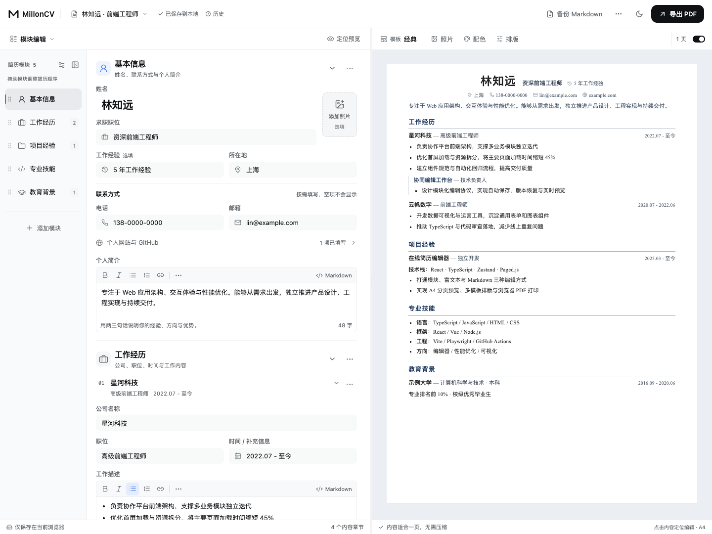
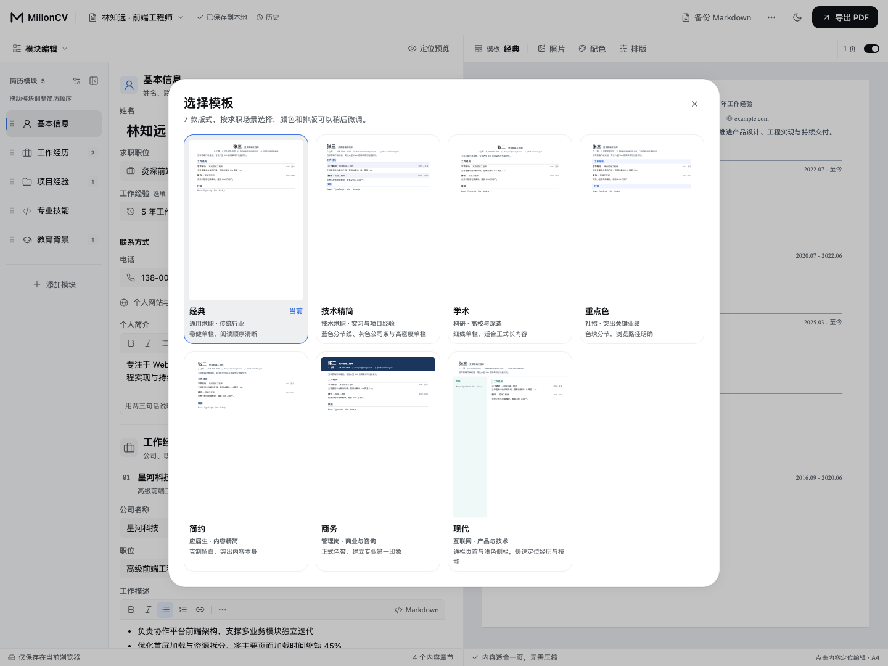
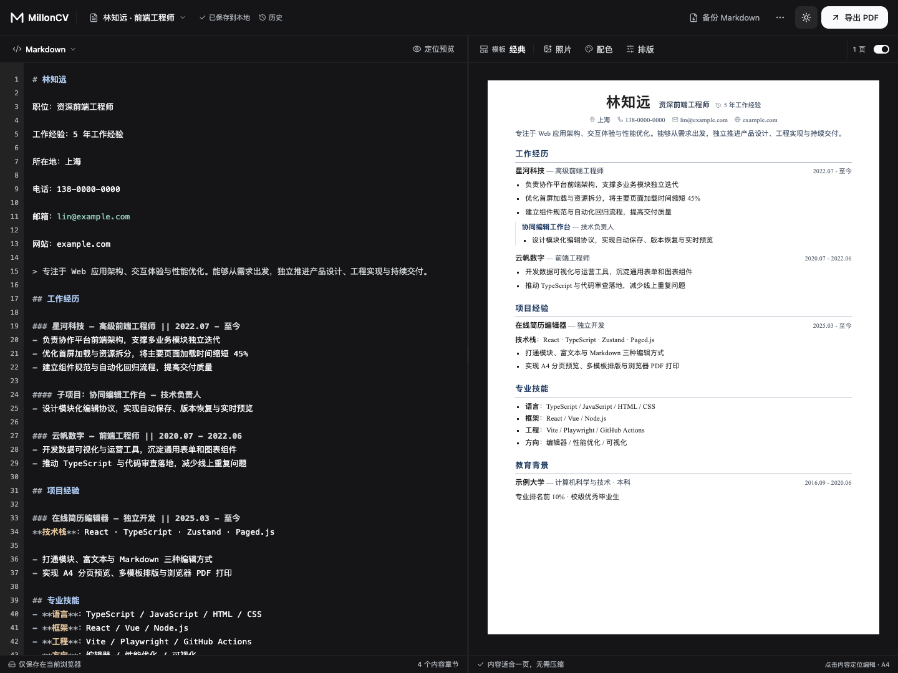
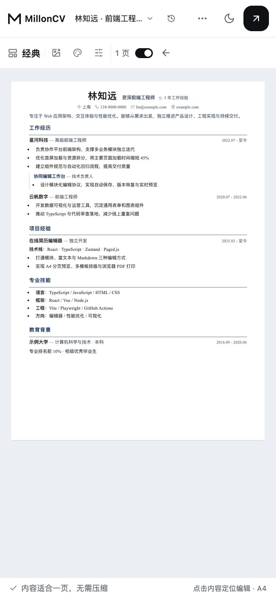

# MillonCV

[简体中文](README.md) | English

> A clear, professional resume for your next step toward a higher salary.

**[Try it online →](https://realcoderandom.github.io/MillonCV/)**

A browser-based resume editor and layout tool. No account or backend needed—resumes are saved locally so you can keep versions per role. Edit via module forms, rich document, or Markdown with live A4 pagination, then print to PDF.

[Features](#features) · [Quick start](#setup) · [Usage](#usage) · [Screenshots](#screenshots) · [Data and backups](#data) · [Troubleshooting](#troubleshooting) · [Development](#development)



> The UI is currently in Chinese; Chinese labels are noted in the guide below.

<a id="features"></a>

## Features

| Feature | Details |
|---|---|
| Three editing modes | Module forms, document editor, and Markdown share the same structured content |
| Experience & modules | Manage work, projects, education, skills, and custom modules; prepend, duplicate, add one-level subprojects, reorder via drag or keyboard, and toggle two-column placement |
| Templates & typography | 7 templates with customizable colors, fonts, sizes, line height, margins, and headings; click or drag to upload a photo and adjust crop/size |
| Live pagination | Live A4 page count in preview and editor bars, click-to-locate editing, and Smart One Page for slight single-page overflows |
| Multiple resumes & recovery | Create (with starter skeleton), duplicate, rename, and switch; local autosave with form undo/redo, queued delete undo, and snapshots |
| Backup & export | Import/export Markdown, print to PDF, and switch between desktop split view and mobile editing/preview |

> Built-in templates: **Classic (`经典`), Technical Compact (`技术精简`), Academic (`学术`), Accent (`重点色`), Minimal (`简约`), Business (`商务`), Modern (`现代`)**; 5 legacy templates remain supported.

<a id="setup"></a>

## Quick start

Requires Node.js **20.19+ (20.x), 22.13+ (22.x), or 24+** and bundled `npm`:

```bash
npm ci
npm run dev
```

Open the URL printed in your terminal (default `http://localhost:5173`). First visit loads a fictional sample resume you can edit or replace.

Build and preview production assets (static output in `dist/`, ready for any static host):

```bash
npm run build
npm run preview
```

<a id="usage"></a>

## Usage

1. **Manage versions**: Create or duplicate resumes from the top menu (new resumes include a blank skeleton). Resume names are separate from the candidate name in the body.
2. **Organize experience**: Fill fields in Module Editing (`模块编辑`) by default—prepend entries, duplicate items, add subprojects or custom modules, reorder by drag or arrow keys, and toggle main/sidebar columns in two-column templates.
3. **Switch modes**: Toggle Module (`模块编辑`), Document (`文档编辑`), and Markdown at the top left. Module mode supports `Enter` / `Tab` / `Ctrl/⌘ + Enter` entry and `Ctrl/⌘ + Z` form undo; click preview blocks to jump to fields, or use Preview (`预览`) on mobile.
4. **Customize styling**: Pick a template in the preview toolbar, or click/drag onto the portrait slot to upload and crop a photo. Colors (`配色`, 6 presets + 2 extra) keep typography intact; Complete Style (`整套风格`) applies color, font, and spacing together; Layout (`排版`) fine-tunes details.
5. **Save & back up**: Watch the top save indicator and use undo or snapshots when needed. Use Back Up Markdown (`备份 Markdown`) to export; import lives under More File Actions (`更多文件操作`).
6. **Export PDF**: Click Export PDF (`导出 PDF`), wait for pagination and fonts, then print with **Save as PDF, A4, 100% scale, no headers/footers** (enable **Background graphics** for template colors). Inspect the exported PDF for page count and breaks.

> [!TIP]
> Smart One Page (`智能一页`) handles slight single-page overflows while keeping longer resumes readable across multiple pages. The final PDF filename is set in your browser's save dialog.

<a id="screenshots"></a>

## Screenshots

### Templates

Seven layouts covering single-column, compact, and sidebar styles—all customizable after selection.



<details>
<summary>Markdown & dark workspace</summary>

Edit Markdown alongside live pagination; workspace light/dark themes do not alter resume paper colors.



</details>

### Mobile support

Edit by field on mobile and switch to the full A4 preview anytime.

| Module editor | A4 preview |
|:---:|:---:|
|  |  |

*Captured in local Chromium (1440 × 1080 desktop, 390 × 844 mobile) with sample data and system fonts. Images live in [`docs/images/`](docs/images/).*

<a id="data"></a>

## Data and backups

Resumes are saved in **`localStorage` for the current browser and site** without cloud sync. Switching browsers, devices, domains, or ports does not transfer data; clearing site data deletes local resumes, and snapshots do not replace external backups.

| Format | Contents | Best for |
|---|---|---|
| Browser autosave | Multiple resumes, content, styles, layouts, and snapshots | Ongoing editing in the same browser/site |
| Markdown backup | Current content, photo, and structure markers (no template/theme/layout/snapshots) | Long-term backup or moving devices (imports with Classic template & default theme) |
| PDF export | Final paginated layout | Submitting or sharing (keep local data or Markdown for future edits) |

> [!IMPORTANT]
> If local data cannot be read, writes pause automatically and raw JSON download is offered. Save it first and do not clear site data; this JSON is for recovery/debugging only and cannot be imported as Markdown.

<a id="troubleshooting"></a>

## Troubleshooting

| Issue | Resolution |
|---|---|
| Install fails | Verify Node.js and npm versions, and check network or proxy settings from the log |
| Save fails | Retry and export Markdown first, then check storage quotas; do not clear site data |
| Unreadable after update | Legacy skill groups migrate automatically; if errors persist, download the raw JSON backup first and keep site data |
| Unexpected Markdown structure | Check the parse notice, undo parsing, or edit in Module mode; keep structure markers in backups |
| Styling resets after import | Markdown omits template, theme, layout, and snapshots; re-select your style after import |
| Font or PDF layout mismatch | Web fonts load via CDN and fall back to system fonts offline; wait for fonts/pagination, check print settings, and inspect the PDF |

Preview and print share the same paginated view; still verify line breaks, links, and completeness in the saved PDF. Tested browsers are listed in the [validation guide](docs/VALIDATION.md#browser).

<a id="development"></a>

## Development

Stack: **React 18 · TypeScript · Vite · Zustand · Tiptap · Paged.js**. See the [development guide](docs/DEVELOPMENT.md) for architecture and [contributing guide](CONTRIBUTING.md) before making changes (currently in Chinese).

| Command | Purpose |
|---|---|
| `npm run dev` | Start dev server |
| `npm run typecheck` | TypeScript type check |
| `npm test` | Unit & architecture tests |
| `npm run lint` | Style & boundary lint |
| `npm run audit:deps` | Audit dependencies via official npm registry |
| `npm run build` | Type-check and build production bundle |
| `npm run test:e2e` | Run Chromium desktop & mobile regressions |

Install Chromium once before E2E with `npx playwright install chromium`. See the [validation guide](docs/VALIDATION.md) for criteria and reports. PRs should summarize changes, doc updates, verification, and any gaps.

[Agent guide](AGENTS.md) · [Contributing](CONTRIBUTING.md) · [Development guide](docs/DEVELOPMENT.md) · [Validation guide](docs/VALIDATION.md)

## License

[MIT License](LICENSE). Third-party dependencies and fonts retain their own licenses.
