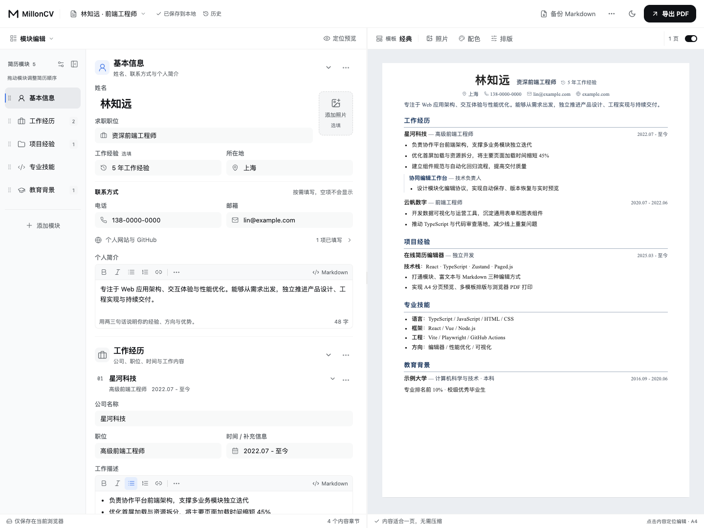
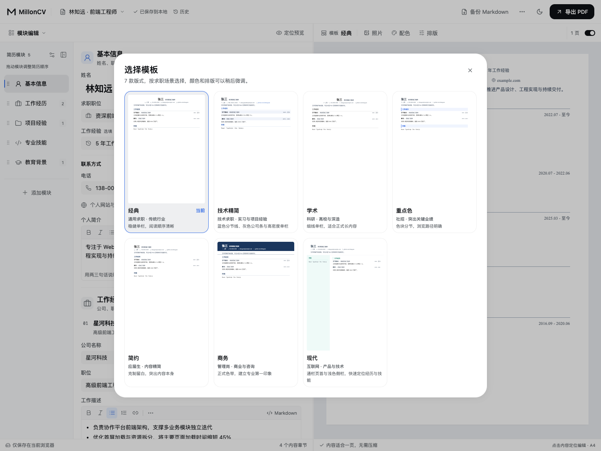
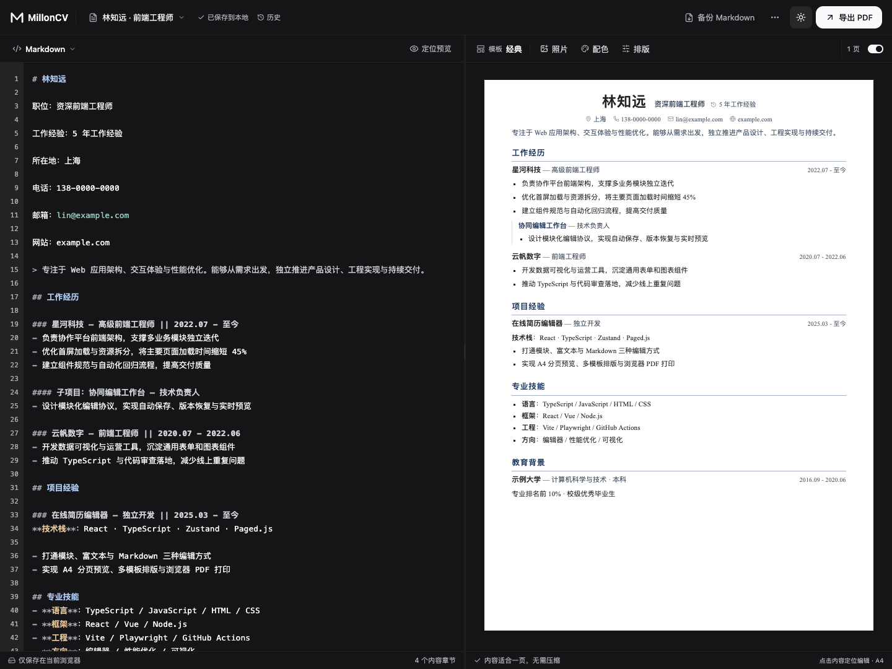
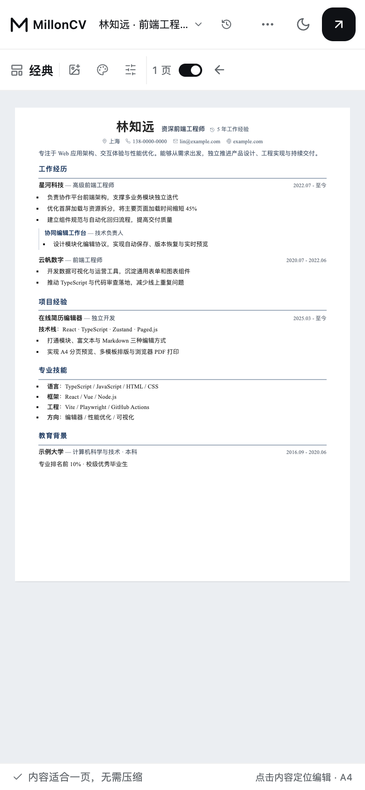

# MillonCV

**为下一份高薪机会，准备一份清晰、专业的简历。**

MillonCV 是一个在浏览器中运行的简历编辑与排版工具。用模块表单整理经历，也可以切换文档或 Markdown 编辑；一边修改，一边查看 A4 分页效果，最后通过浏览器打印保存为 PDF。

[功能概览](#features) · [快速开始](#setup) · [使用指南](#usage) · [界面预览](#screenshots) · [数据与备份](#data) · [开发与协作](#development)



无需账号、后端服务或环境变量。简历保存在当前浏览器中，可以针对不同岗位维护多个版本。

<a id="features"></a>

## 功能概览

| 能力 | 可以做什么 |
|---|---|
| 三种编辑方式 | 模块表单按字段填写，文档编辑连续书写，Markdown 直接修改源码；三种方式共享同一份简历内容 |
| 经历与模块管理 | 管理工作、项目、教育、技能及自定义模块；支持一级子项目、模块排序，以及双栏模板的主栏与侧栏安排 |
| 模板与排版 | 7 套可选模板，调整配色、字体、字号、行高、边距和标题；支持上传照片并调整显示尺寸 |
| 实时分页预览 | 查看实际 A4 页数，点击预览内容定位编辑；智能一页可在安全范围内收紧略超一页的内容 |
| 多简历与恢复 | 新建、复制、重命名和切换简历；自动本地保存、历史快照恢复与删除撤销 |
| 备份与导出 | 导入、导出 Markdown；通过浏览器打印保存 PDF；桌面双栏工作区与手机编辑 / 预览切换 |

可选模板：**经典、技术精简、学术、重点色、简约、商务、现代**。另兼容 5 套历史模板，已有简历继续使用原版式。

<a id="setup"></a>

## 快速开始

准备 Node.js **20.19+（20.x）、22.13+（22.x）或 24+**，以及 **pnpm 9+**（CI 使用 pnpm 9）。在项目根目录执行：

```bash
pnpm install --frozen-lockfile
pnpm dev
```

打开终端显示的本地地址，默认是 `http://localhost:5173`；端口被占用时以实际输出为准。首次打开会载入示例简历，可以直接修改或新建自己的简历。

预览生产构建：

```bash
pnpm build
pnpm preview
```

应用是纯前端项目，构建产物位于 `dist/`，可托管在静态站点服务中。

<a id="usage"></a>

## 使用指南

1. **创建岗位版本**：打开顶部简历名称菜单，新建或复制一份简历。版本名称与正文姓名独立，适合分别维护不同岗位的内容。
2. **填写与整理经历**：默认在「模块编辑」中按字段填写，添加经历、一级子项目或自定义模块。通过模块目录调整顺序；双栏模板还可以安排主栏与侧栏。
3. **选择编辑方式**：在编辑区左上角切换「模块编辑」「文档编辑」或「Markdown」。预览中的内容可点击定位到对应表单；手机上用「预览」与返回编辑按钮切换视图。
4. **调整简历样式**：在预览工具栏选择模板，上传照片并调整尺寸；「配色」提供 6 个常用色和 2 个更多色，换色保留排版。「整套风格」会同时应用颜色、字体和间距，「排版」可逐项微调。
5. **检查保存并备份**：确认顶部保存状态，按需查看历史快照或撤销删除。点击「备份 Markdown」导出当前内容；导入入口在「更多文件操作」中。
6. **保存 PDF**：点击「导出 PDF」，确认分页和字体就绪。在浏览器打印窗口选择**另存为 PDF、A4、100% 缩放、关闭页眉页脚**；需要配色时开启背景图形。保存后打开文件检查页数与断行。

「智能一页」适合略超一页的简历；内容过多时会保留可读字号与多页结果，仍需自行精简内容。PDF 文件名最终由浏览器保存窗口决定。

<a id="screenshots"></a>

## 界面预览

### 选择适合岗位的模板

7 套版式提供单栏、紧凑与侧栏等选择，选定后仍可调整配色和排版。



<details>
<summary>Markdown 与深色工作区</summary>

源码与排版结果并排显示；切换界面深浅主题不会改变简历纸张的配色。



</details>

### 手机端编辑与预览

按字段修改内容，需要检查版式时切换到完整页面预览。

| 模块编辑 | A4 预览 |
|:---:|:---:|
|  |  |

截图来自本地 Chromium，桌面视口为 1440 × 1080，手机视口为 390 × 844；使用虚构示例内容与系统字体。图片保存在仓库的 [`docs/images/`](docs/images/) 中。

<a id="data"></a>

## 数据与备份

简历自动保存到**当前浏览器、当前站点的 localStorage**，没有云同步。更换浏览器、设备、站点地址或端口后，不会自动带入原有简历；清理站点数据会删除本地内容，历史快照也不能代替外部备份。

| 保存方式 | 包含内容 | 使用场景 |
|---|---|---|
| 浏览器自动保存 | 多份简历、正文、样式、布局及历史快照 | 在同一浏览器与站点继续编辑 |
| Markdown 备份 | 当前简历正文、照片和结构标识；不含模板、主题、预览布局及快照 | 保留可编辑内容，迁移到其他浏览器或设备；导入后使用经典模板与默认主题 |
| PDF | 当前分页与排版的最终文档 | 投递或分享；继续编辑时仍需保留浏览器数据或 Markdown 备份 |

若无法读取本地数据，应用会暂停写入并提供原始 JSON 下载。先保留原始备份，再排查权限或数据问题；这个 JSON 用于恢复和排障，不能当作 Markdown 文件导入。

<a id="troubleshooting"></a>

## 常见问题

| 情况 | 处理方法 |
|---|---|
| 安装依赖失败 | 确认 Node.js 与 pnpm 版本符合要求，按安装日志检查网络或代理 |
| 保存失败 | 先重试并导出 Markdown，再检查浏览器存储限制；不要先清理站点数据 |
| 更新后无法读取简历 | 新版会自动迁移旧技能分组；若仍出现格式异常，先下载原始 JSON 备份再排查，不要清理站点数据 |
| Markdown 结构识别不符 | 查看解析提示，必要时撤销解析，或回模块模式修改；备份中的结构标识应保留 |
| 导入后样式变化 | Markdown 不携带模板、主题、预览布局与快照，导入后需重新选择样式 |
| 字体或 PDF 排版变化 | Web 字体依赖 CDN，离线会回退；等待字体与分页完成，检查打印设置，再核对实际 PDF |

预览与打印共用分页页面，实际 PDF 仍需检查断行、链接和内容是否完整。项目暂未声明正式浏览器支持矩阵，浏览器验证范围见[验证指南](docs/VALIDATION.md#browser)。

<a id="development"></a>

## 开发与协作

主要技术栈：**React 18 · TypeScript · Vite · Zustand · Tiptap · Paged.js**。架构、数据流、模板扩展与编辑协议集中维护在[开发文档](docs/DEVELOPMENT.md)，参与开发前先阅读[贡献与文档维护](CONTRIBUTING.md)。

| 命令 | 用途 |
|---|---|
| `pnpm dev` | 启动开发服务 |
| `pnpm typecheck` | TypeScript 类型检查 |
| `pnpm test` | 运行单元与架构测试 |
| `pnpm lint` | 静态检查 |
| `pnpm build` | 类型检查并生成生产产物 |
| `pnpm test:e2e` | 构建后运行 Chromium 桌面与手机回归 |

首次运行 E2E 前执行 `pnpm exec playwright install chromium`。检查选择、通过标准和浏览器报告位置见[验证指南](docs/VALIDATION.md)；提交或交付时写清改动原因、相关文档、实际验证与未覆盖项。

[Agent 入口](AGENTS.md) · [贡献指南](CONTRIBUTING.md) · [架构与工程约定](docs/DEVELOPMENT.md) · [验证指南](docs/VALIDATION.md)

## 授权说明

私有项目，未开源。
