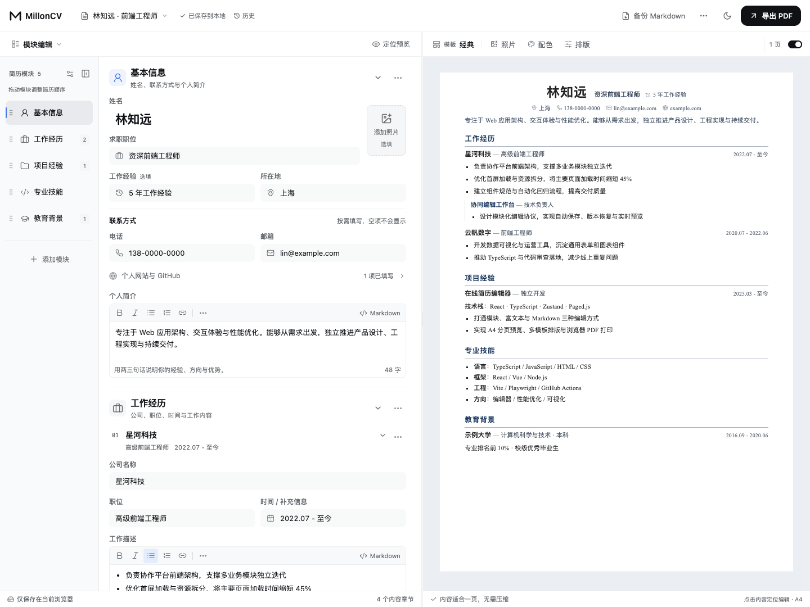
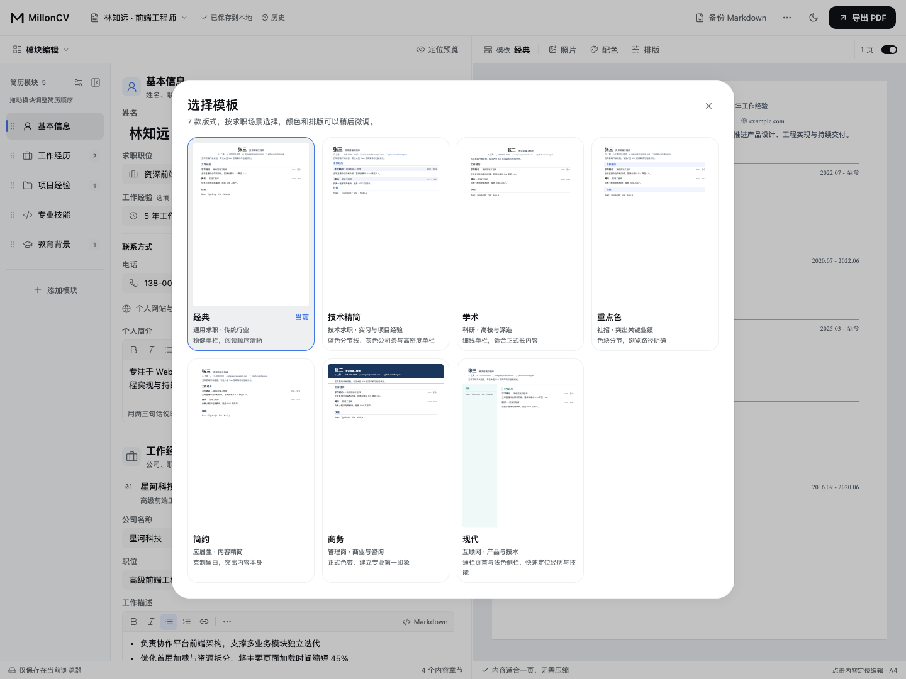
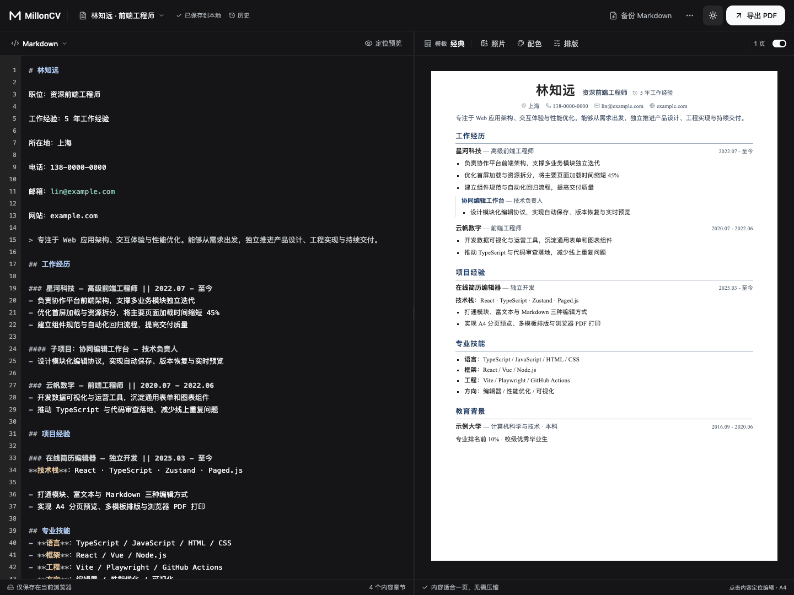
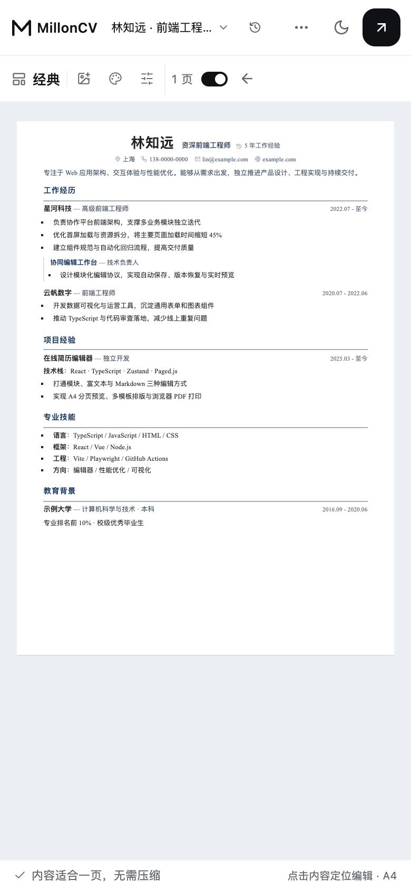

# MillonCV

简体中文 | [English](README.en.md)

> 为下一份高薪机会，准备一份清晰、专业的简历。

**[在线体验 →](https://realcoderandom.github.io/MillonCV/)**

纯浏览器运行的简历编辑与排版工具。无需账号或后端，简历自动保存在本地，可按岗位维护多个版本。支持模块表单、文档与 Markdown 三种编辑模式，实时预览 A4 分页，并通过浏览器打印导出 PDF。

[功能概览](#features) · [快速开始](#setup) · [使用指南](#usage) · [界面预览](#screenshots) · [数据与备份](#data) · [常见问题](#troubleshooting) · [开发与协作](#development)



<a id="features"></a>

## 功能概览

| 功能 | 说明 |
|---|---|
| 三种编辑模式 | 模块表单、文档编辑、Markdown 源码共享同一份结构化正文 |
| 经历与模块 | 管理工作、项目、教育、技能与自定义模块；支持一级子项目、复制、置顶添加、拖拽/键盘排序，以及双栏主侧栏切换 |
| 模板与排版 | 7 套模板，自定义配色、字体、字号、行高、边距与标题；支持点击或拖拽上传证件照，并微调裁切与尺寸 |
| 实时分页 | 预览区与编辑区底栏同步显示 A4 页数，点击预览定位表单；「智能一页」可在可读范围内收紧略超一页的内容 |
| 多简历与恢复 | 新建（自带空白骨架）、复制、重命名与切换；本地自动保存，支持表单级撤销 / 重做、连续删除撤销与历史快照 |
| 备份与导出 | 导入 / 导出 Markdown，浏览器打印保存 PDF；适配桌面双栏与移动端视图切换 |

> 内置模板：**经典、技术精简、学术、重点色、简约、商务、现代**；另兼容 5 套历史模板。

<a id="setup"></a>

## 快速开始

需要 Node.js **20.19+（20.x）、22.13+（22.x）或 24+** 及自带 `npm`：

```bash
npm ci
npm run dev
```

打开终端输出的地址（默认 `http://localhost:5173`）。首次访问会加载虚构示例简历，可直接修改或新建。

构建并预览生产产物（静态文件输出至 `dist/`，可直接托管）：

```bash
npm run build
npm run preview
```

<a id="usage"></a>

## 使用指南

1. **管理简历版本**：在顶部简历菜单新建或复制简历（新建自带空白骨架）；简历名称与正文姓名相互独立，方便按岗位区分。
2. **整理经历**：默认在「模块编辑」按字段填写，支持顶部快捷添加、复制条目、子项目与自定义模块；可用拖拽或方向键排序，双栏模板可在目录或标题栏一键切换主栏与侧栏。
3. **切换编辑模式**：在编辑区左上角切换「模块编辑」「文档编辑」与「Markdown」。模块编辑支持 `Enter` / `Tab` / `Ctrl/⌘ + Enter` 连续录入及 `Ctrl/⌘ + Z` 表单撤销；点击预览可定位表单，手机端通过「预览」切换视图。
4. **调整样式**：在预览工具栏选模板，点击或拖入图片到头像框上传证件照并微调裁切与尺寸。「配色」（6 个常用色 + 2 个更多色）仅改颜色，「整套风格」同步套用配色、字体与间距，「排版」可逐项微调。
5. **保存与备份**：留意顶部保存状态，按需使用撤销或历史快照；点击「备份 Markdown」导出正文，导入位于「更多文件操作」。
6. **导出 PDF**：点击「导出 PDF」待分页与字体就绪后，在打印窗口选择**另存为 PDF、A4、100% 缩放、关闭页眉页脚**（需保留底色时开启**背景图形**），保存后核对页数与断行。

> [!TIP]
> 「智能一页」适合略超一页的内容，过多时会保留可读字号与多页排版；PDF 文件名由浏览器保存窗口决定。

<a id="screenshots"></a>

## 界面预览

### 模板选择

7 套版式涵盖单栏、紧凑与侧栏，选定后仍可自由调整配色与排版。



<details>
<summary>Markdown 与深色工作区</summary>

源码与分页并排预览；切换工作区深浅主题不影响简历纸张配色。



</details>

### 移动端适配

按字段编辑内容，随时切换完整 A4 预览。

| 模块编辑 | A4 预览 |
|:---:|:---:|
|  |  |

*截图采自本地 Chromium（桌面 1440 × 1080，手机 390 × 844），使用示例数据与系统字体，原图见 [`docs/images/`](docs/images/)。*

<a id="data"></a>

## 数据与备份

简历保存在**当前浏览器与站点的 `localStorage`**，无云同步。更换浏览器、设备、地址或端口不会迁移数据；清理站点数据会清除本地简历，历史快照也不能替代外部备份。

| 方式 | 包含内容 | 适用场景 |
|---|---|---|
| 浏览器自动保存 | 多份简历、正文、样式、布局与历史快照 | 同一浏览器与站点继续编辑 |
| Markdown 备份 | 当前正文、照片与结构标识（不含模板、主题、布局与快照） | 长期备份或跨设备迁移（导入后使用经典模板与默认主题） |
| 导出 PDF | 当前分页与排版的最终文档 | 投递与分享（后续修改需保留本地数据或 Markdown） |

> [!IMPORTANT]
> 本地数据无法读取时，应用会暂停写入并提供原始 JSON 下载。请先保留备份再排查，切勿先清理站点数据；该 JSON 仅用于恢复排障，不可当作 Markdown 导入。

<a id="troubleshooting"></a>

## 常见问题

| 问题 | 处理方式 |
|---|---|
| 依赖安装失败 | 检查 Node.js 与 npm 版本，按日志排查网络或代理 |
| 保存失败 | 先重试并导出 Markdown，再检查存储配额；勿先清理站点数据 |
| 更新后无法读取 | 旧技能分组会自动迁移；若仍异常，先下载原始 JSON 备份再排查，勿清理站点数据 |
| Markdown 结构异常 | 查看解析提示，可撤销解析或回「模块编辑」修改；备份中的结构标识需保留 |
| 导入后样式变化 | Markdown 不含模板、主题、布局与快照，导入后重新选择样式即可 |
| 字体或 PDF 排版偏差 | Web 字体依赖 CDN，离线会回退系统字体；待字体与分页就绪后检查打印设置，并核对导出的 PDF |

预览与打印共用分页视图，保存后仍建议核对断行、链接与内容完整性。已验证浏览器范围见[验证指南](docs/VALIDATION.md#browser)。

<a id="development"></a>

## 开发与协作

技术栈：**React 18 · TypeScript · Vite · Zustand · Tiptap · Paged.js**。架构与约定见[开发文档](docs/DEVELOPMENT.md)，参与协作请先阅读[贡献指南](CONTRIBUTING.md)。

| 命令 | 说明 |
|---|---|
| `npm run dev` | 启动开发服务 |
| `npm run typecheck` | TypeScript 类型检查 |
| `npm test` | 单元与架构测试 |
| `npm run lint` | 代码风格与包边界检查 |
| `npm run audit:deps` | 通过 npm 官方接口审计依赖安全 |
| `npm run build` | 类型检查并构建生产产物 |
| `npm run test:e2e` | 运行 Chromium 桌面与移动端回归 |

首次运行 E2E 前先执行 `npx playwright install chromium`。验证标准与报告路径见[验证指南](docs/VALIDATION.md)；提交时说明改动原因、关联文档、验证结果与未覆盖项。

[Agent 指南](AGENTS.md) · [贡献指南](CONTRIBUTING.md) · [开发文档](docs/DEVELOPMENT.md) · [验证指南](docs/VALIDATION.md)

## 开源协议

基于 [MIT License](LICENSE) 开源；第三方依赖与字体遵循各自许可证。
